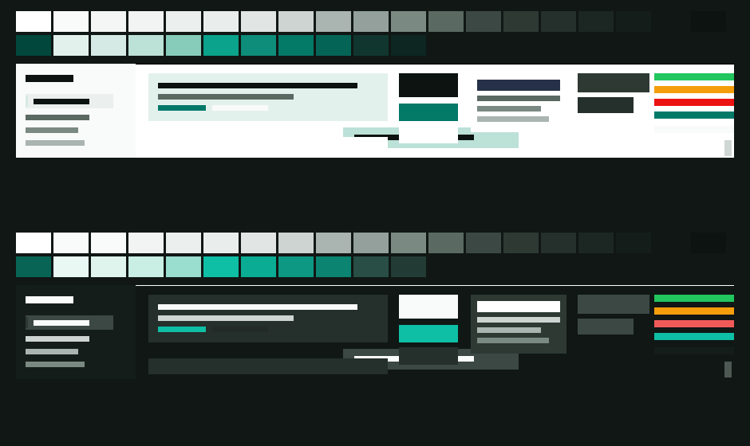

# dsh-theme-inkstone 砚

DeepSeek Harness Web 客户端的主题插件。配色方向是**暖墨加一点朱砂**：纸白的暖中性阶，
一个朱砂红承担全部强调色。两个目标，按优先级排序：

1. **会话可读性**——正文、气泡、代码块、输入框、侧栏的每一对前景/背景都有对比度下限，
   生成器不达标就不产出。
2. **可选的背景图**——一张图铺在会话后面，上面盖一层固定强度的表面色遮罩，再叠一点模糊。
   默认关闭，纯色表面就是完整主题。

它注册**两个可选主题**（`inkstone-light` / `inkstone-dark`）和**一个设置行**，不碰布局、
不改动 DSH 自带的外观设置。装上之后默认选中「砚 · 浅色」，随时可以在设置里切回原主题。

```
纸白  #faf7f2        暖中性阶：OKLCH 80°，彩度 0.006–0.016
墨黑  #191513        深色表面，同样暖偏
朱砂  #c41002        浅色强调（对比度 5.74:1）
      #db6150        深色强调（对比度 5.04:1）
```



<sub><i>深浅两套调的对比，由 <code>tools/render-preview.mjs</code> 从真实 token 值绘制。
想看交互效果请打开 <code>preview.html</code>：正文、气泡、代码块、菜单、状态色，含遮罩强度滑杆。</i></sub>

## 它做了什么

**149 个 token + 8 个非颜色声明**，全部按 `{light, dark}` 成对写出：

| 来源 | 数量 | 说明 |
|---|---|---|
| 色阶成员 | 63 | 暖墨中性阶（80°）、朱砂强调（30°）、原样保留的绿/琥珀/红/蓝/紫族 |
| 语义 token | 75 | 69 个由色阶别名派生，3 个字面量 hex 改为指向色阶，2 个纯前景色单独抬到下限，1 个阅读表面 |
| 代码高亮 | 11 | 9 个 `--shiki-token-*` 对代码块重新定标 + 前景/背景 |
| 非颜色 | 8 | 正文/代码字体栈（`--dsh-font-*`，设置里的字体行读的就是它们）、圆角 |

### 两条来自实测的约束

**一、对比度由相对亮度决定，不是 OKLCH 明度。** 同一明度下挪色相，对比度能差 0.08 个
亮度值——link 在浅色下因此从 4.23 掉到 3.9。所以生成器的做法是：**保留色相、求解对比度**。
每个受力面的种子写一个目标比值，生成器在 OKLCH 里二分明度（不够就退彩度）直到命中。

**二、朱砂需要三样东西同时约束，否则会变成"深红"或"珊瑚粉"。**

| 约束 | 作用 | 不做的后果 |
|---|---|---|
| `target: 5.6` | 比 4.5 下限略高 | 刚好卡在 4.5 时，求解器把彩度压到 0.16，红变暗红 |
| `maxLightness` | 浅色上限 0.52 / 深色 0.64 | 深色下会算到明度 0.74，橙红色域只剩 0.15 彩度，成荧光粉 |
| `minChroma: 0.2` | 绝对彩度下限 | 基线的深色蓝彩度只有 0.10，乘系数后仍是弱红 |

深色朱砂的物理上限：在深色表面上要维持 5:1 对比度，明度得 0.74，而那个亮度的橙红色域
只够 0.16 彩度。所以深色取的是 `#db6150`（5.04:1、彩度 0.157），这是两者能同时满足的边界。

### 可读性门禁：38 组配对

所有配对都在**合成后**的颜色上算：半透明 token 先叠到表面上，再算 WCAG 对比度。
基线本身有 3 组低于阈值（caption 1.98、warning 2.79、success 2.28），本主题**全部修到下限之上**：

| 模式 | 场景 | 浅色 | 深色 | 结果 |
|---|---|---|---|---|
| 正文 | `label-primary` on `bg-base` | 17.67:1 | 17.30:1 | PASS（下限 7.0） |
| 代码块 | `label-primary` on `markdown-code-block` | 18.01:1 | 16.44:1 | PASS（下限 7.0） |
| 气泡 | `label-primary` on `specific-bubble` | 16.22:1 | 12.93:1 | PASS（下限 7.0） |
| 输入框 | `label-primary` on `input-major` | 17.71:1 | 12.93:1 | PASS（下限 7.0） |
| 引用块 | `label-primary` on `markdown-citation` | 16.10:1 | 11.52:1 | PASS（下限 7.0） |
| 次要文字 | `label-secondary` | 5.44:1 | 12.36:1 | PASS（下限 4.5） |
| 辅助文字 | `label-tertiary` | 5.42:1 | 8.48:1 | PASS（下限 4.5） |
| 朱砂链接 | `link` on `bg-base` | 5.74:1 | 5.04:1 | PASS（下限 4.5） |
| 说明文字 | `label-caption` | 3.20:1 | 4.90:1 | PASS（下限 3.0，基线 1.98） |
| 警告文字 | `state-warn-label` | 3.05:1 | 6.71:1 | PASS（下限 3.0，基线 2.79） |

**38 组全部 PASS，没有 INHERITED，没有 BROKEN。** 基线那 3 组低于阈值的
（caption 1.98、warning 2.79、success 2.28）全部被抬到下限之上；success 是绿族，
属于"不动颜色含义"的范围，它靠的是中性的不动 + 表面色略深一点的重新计算，不是改绿。

`node tools/palette.mjs` 一次跑完所有配对，任何一组跌破下限就 `exit 1`；最弱的三组会打印出来。

## 背景图

默认不启用。背景层做两件事，**顺序就是可读性的保证**：

1. 一张图固定在视口上（不随会话滚动）；
2. 盖一层**同色表面色**，不透明度浅色 82% / 深色 88%，再叠 3px 模糊。

遮罩是**不透明基底的一部分**：图再花，文字永远读在遮罩上，而所有对比度配对就是按这个颜色算的。
模糊只是装饰，掉帧或不被支持都不影响可读性。

背景层依赖 DSH 自己的 DOM 属性，不依赖哈希类名，并做了三件事：

- 挂载前探测 `[data-conversation-content]` / `[data-chat-turn]`，找不到就**自我放弃并 warn**；
- 只清空四个真正画实色背景的容器的背景；
- `ctx.effect` 里注册清理，卸载时把 `<style>`、`data-dsh-inkstone-bg` 属性和三个 CSS 变量全部回收。

**启用方式**：运行时设置 `globalThis.__INKSTONE_BACKGROUND__ = { url: "file:///..." }`（或 `data:` URL、
`http:` 地址）。没有设置它就是纯色主题。**这是全部——不读设置文件、不做界面**，因为你只说"图后面再找"。

## 安装

> **先确认目标 profile。** 桌面客户端（Electron）读的是 `desktop`，CLI 默认的 `web` 是另一套。
> 装错 profile 的症状很难查：服务端完全正常（层栈、软链、patch 全对），但界面毫无变化。

**桌面端（`desktop` profile）**——该 profile 被 Electron 独占，CLI 会直接拒绝：

```sh
dsh plugin --profile desktop add E:\github_own\dsh-theme-inkstone
# error: profile "desktop" is managed exclusively by the Electron application
```

实测可行的做法是**不经过 pnpm 重装**，只改清单 + 建软链：

1. 编辑 `$DSH_HOME/profiles/desktop/package.json`：
   - `dependencies` 里加 `"dsh-theme-inkstone": "link:E:/github_own/dsh-theme-inkstone"`
   - `dsh.profile.bundles` 末尾加 `"dsh-theme-inkstone"`
2. 在该 profile 的 `node_modules/` 下建一条软链指向本地检出：
   `ln -s /e/github_own/dsh-theme-inkstone node_modules/dsh-theme-inkstone`
   （Windows 下用 `mklink /D`，或 Git Bash 的 `ln -s`）
3. 重启桌面客户端。

**不要运行 `pnpm install`。** 改了清单后 pnpm 会判定 `node_modules` 需要重建
（`hoisted` 模式下会清空整个目录），这个 profile 装着几十个插件，重装失败会导致客户端
起不来——而本地链接根本不需要重装，软链一步就够了。

**命令行 profile（`web`）**：

```sh
dsh plugin --profile web add E:\github_own\dsh-theme-inkstone
```

`dsh plugin` 是 pnpm 的转发器；装完它把包名加进该 profile 的 `dsh.profile.bundles` 层栈。
**重启对应进程后生效**——运行中的进程不会重读层栈。

卸载：`dsh plugin --profile <name> remove dsh-theme-inkstone`，`ctx.effect` 精确回收两层。
desktop profile 同样要走界面或 pnpm。

## 开发时容易踩的两件事

**一、`factory` 必须接收 `require`。** 模块表把 `require` 作为 factory 的参数传进来；
写成 `factory: () => {}` 再在内部调用 `require("react")` 会抛 `ReferenceError`，
而这次异常发生在 `apply` 期间，**直接把整个页面拖垮了**。

```js
// 对
factory: (require) => { const React = require("react"); ... }
// 错——require 不存在
factory: () => { const React = require("react"); ... }
```

**二、`apply` 的每一步都要异常隔离。** 主题是装饰，设置行挂不上也不该让应用起不来。
`apply` 里用 `step(label, fn)` 包住每一段，失败只 `console.warn`。

这两条都由 `tools/check.mjs` 守着（"factory accepts require" / "apply steps are isolated"）。

## 动效与质感

全部来自一个 `<style>`（`tools/motion.mjs`），只用标准 CSS 选择器，不碰 DSH 的哈希类名。

| 效果 | 实现 | 退路 |
|---|---|---|
| 主题切换过渡 | `body` 与对话容器的 `background-color`/`color` 180ms 缓动 | 无（纯过渡） |
| 选区色 | `::selection` 用朱砂暖调，替换浏览器默认蓝 | 无 |
| 焦点环 | `:focus-visible` 朱砂描边 + 28% 透明度光晕 | 无 |
| 消息上浮 | `[data-chat-turn]` 6px 上移淡入，220ms | 靠 DSH 属性，属性没了只是不播 |
| 面板弹出 | 菜单/对话框 `scale(.985)` 展开，140ms | 同上 |
| 光标色 | `caret-color` 跟随强调色 | 无 |

**两条硬约束：**

1. **动效不影响可读性。** 选区是"文字背景"，所以它也要过门禁：浅色 `#ffbfb4` 上是
   12.0:1，深色 `#753930` 上是 8.4:1，都高于正文的 4.5 下限。这两个值由
   `deriveMotion()` 算出来并写进 `report.json`，不是手填的。
2. **尊重 reduced-motion。** 所有动画都在 `@media (prefers-reduced-motion: no-preference)`
   里；系统设了减少动效时，一切瞬间完成、无位移。

背景图也并进了同一个 `<style>`，卸载时整块回收。

## 怎么切换

设置 → 通用 里有一行「砚 · 主题」：

- **开关**：打开即用砚，关闭立刻回到 DSH 自带外观
- **浅色 / 深色**：开关打开时出现，两个 chip 切换方案
- 副标题实时显示当前状态（"已启用「砚 · 浅色」" / "已关闭，使用 DSH 自带外观"）

**装上默认就是开启、浅色。** 选择记在 localStorage，重启后保持。
关闭时用的是安装前 DSH 的偏好（浅色/深色/跟随系统），不会强推任何一种。

## 装好之后怎么确认

控制台执行：

```js
getComputedStyle(document.body).getPropertyValue('--dsw-alias-bg-base')
```

- `#faf7f2`（浅色）/ `#191513`（深色）→ 生效
- `#fff` / `#151517` → 未生效，先查是不是装错了 profile

再查链接色 `--dsw-alias-link`：生效时是 `#c41002`（浅）/ `#db6150`（深），
未生效时是基线的 `#4176e6` / `#7aaaff`。


## 开发

```sh
node tools/palette.mjs        # 读基线 → 求解配色 → 跑门禁 → 写 tokens.json / report.json
node tools/build-client.mjs   # tokens.json → lib/client.js
node tools/check.mjs          # 14 项产物检查
node tools/preview.mjs        # → preview.html
node tools/render-preview.mjs # → preview.png（Node 自绘 PNG，不经过浏览器）
npm run verify                # 以上全部
```

**没有打包步骤。** 纯配色主题用不到 React / JSX / 样式表导入，所以 `lib/client.js`
由 `tools/build-client.mjs` 拼装生成，签入仓库。

### 重新调色

改 `tools/palette.mjs` 顶部的常量，然后重跑 `palette` + `build:client`：

| 常量 | 作用 |
|---|---|
| `FAMILIES` | 各色族的目标 OKLCH 色相、彩度系数、`minChroma`、`lightnessCap` |
| `PRESERVED_FAMILIES` | 保持基线原样的色族（绿/琥珀/红：改状态色是改含义，不是主题化） |
| `TARGETS` | 每个种子要解的对比度比值，可带 `maxLightness`（按模式的明度上限） |
| `SURFACE` | 阅读表面（浅 `#faf7f2` / 深 `#191513`），也是遮罩色 |
| `OVERLAY` | 背景遮罩强度（浅 0.82 / 深 0.88） |
| `PAIRS` | 门禁配对与下限 |
| `TYPOGRAPHY` / `RADIUS` | 字体栈与圆角 |

**换一个强调色时的顺序**（朱砂就是这么调出来的，换成别的色相同理）：

1. 在 `FAMILIES` 里改色相，先给一个偏低的 `minChroma`（0.1 左右）看基线会产出什么；
2. 跑一次 `palette`，记下强调色在浅/深两侧的实测对比度；
3. 若浅色偏暗（彩度被压掉）→ 提高 `target`；若深色偏荧光 → 降 `maxLightness`；
4. 两者都调到满意，再把 `minChroma` 抬到目标色相在 sRGB 里放得下的值。

彩度上限受色域限制：明度越高，同色相能放下的彩度越小。深色强调色永远比浅色淡一档，
这是几何决定的，不是没调好。

### `check.mjs` 查什么

20 项，只证明磁盘上的产物互相自洽、且与已安装的 DSH 一致，不复算颜色：

**产物自洽**

1. `tokens.json` 名字合法、无重复键、每项都有 light/dark；
2. `tokens.json` 与当前生成器输出逐 token 一致；
3. `lib/client.js` 的两份调色板都与 `tokens.json` 完全一致；
4. `package.json` / `cordis.patch.yml` / bundle id 三者同名；
5. `exports` 指向的文件存在。

**与已安装 DSH 一致**

6. 每个 token 在已安装的 DSH 里仍然存在（升级后第一时间发现）；
7. 背景层依赖的四个 DOM 属性仍在对话包里；
8. 被清空背景的容器默认仍是 `var(--dsw-alias-bg-base)`。

**运行时契约**（这几条都是踩过坑补上的）

9. `factory` 接收 `require`（否则整页崩）；
10. `apply` 的每一步都隔离（失败不波及宿主）；
11. 初始选择等主题真正注册后再切换（否则默认静默失效）；
12. 客户端 inject 了 `theme` 与 `slots`、注册两主题 + 设置行、写 localStorage、能还原原主题、
    **不用 overrideTokens 强推**；
13. 宿主半侧仍是无副作用的空 `apply()`。

**可读性与动效**

14. 38 组会话配对全 PASS，且报告来自当前基线；
15. 选区色对文字的对比度过 4.5 下限；
16. 动效全部置于 `prefers-reduced-motion` 守卫内；
17. 样式层可回收。

## 与基线的差异

| 项 | 结论 |
|---|---|
| 主题注册 id | 用 `register()` 注册 `inkstone-light` / `inkstone-dark`。第三方 id 不写入设置文件，所以选择存在 localStorage；每次启动按存储值恢复 |
| 状态色阶 | 完全保留基线。状态胶囊底色（`*-tertiary`）跟着色阶走，只换中性阶与强调色 |
| 代码块 | 9 个 Shiki token 对**改色后的代码块**重解对比度，不是复制基线的明度 |
| 字体 | 只覆盖 `--dsh-font-*` 默认栈，不替换成具体字体，机器缺字体时回落到系统栈 |

## 已知限制

- **背景层是唯一的脆弱点。** 它依赖 DSH 的 DOM 属性；属性一改，图上不来（会 warn），但配色不受影响。
  `check.mjs` 第 11/12 项就是为了在升级后立刻告诉你。
- **背景图需要手动设置一个全局变量。** 没有设置界面——要的话得先确认 DSH 的设置项 API 再说。
- **`--dsw-alias-label-primary` 只有一组值**，深色下要同时读在页面表面（17.8:1）和菜单分组标题、
  提示框这类近白/近黑浮层上。浮层上的配对已经在门禁里覆盖并通过；这不是拆分 token 的问题，
  而是这类浮层本来就该用 `--dsw-alias-tooltip-label` 之类的专用前景色。
- **依赖源码扫描。** 基线从已安装的 `dsh-client-ui-theme` 包里读；bundle 布局一变，
  生成器会**明确报错**而不是产出错色板。
